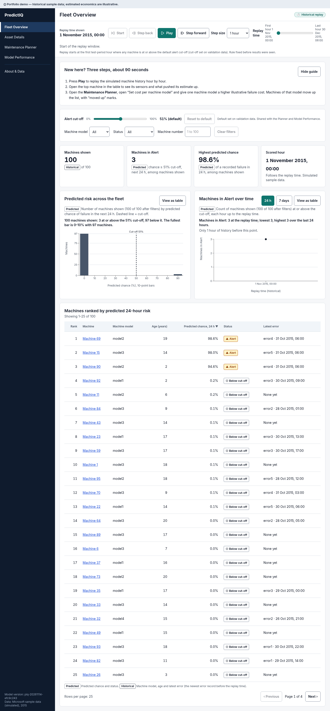
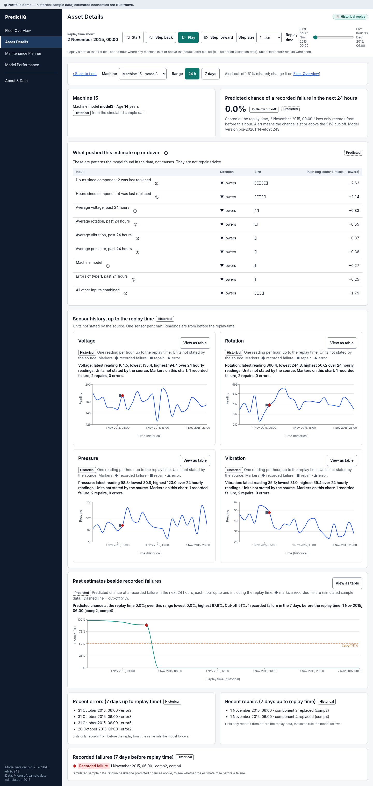
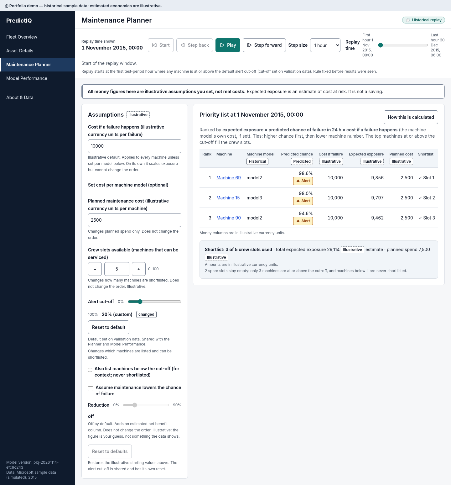
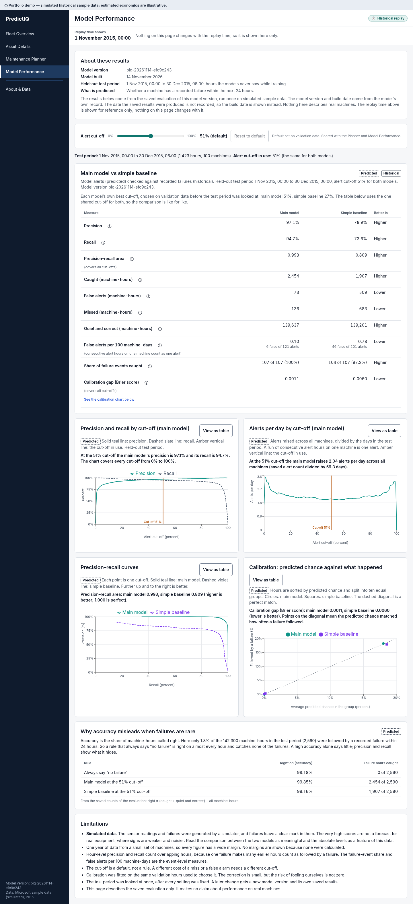

# PredictIQ

PredictIQ is a prototype asset-intelligence application built on a public predictive-maintenance sample dataset. It predicts recorded component failures over a 24-hour horizon and links model outputs to transparent, assumption-based maintenance prioritization. It is a demonstration of industrial analytics and product design, not a deployed production system.

**Live demo:** (added at launch)

> Portfolio demo — simulated historical sample data; estimated economics are illustrative.

Everything you see comes from **simulated** data: 100 made-up machines over one year, published by Microsoft as a teaching sample. No real plant, fleet or mine data is used, and nothing here is a claim about real equipment. Money figures in the planner are illustrative assumptions, not real costs.

## What you can do in it

The demo replays a fixed historical period. You pick a time, and the five pages show what the models knew then.

| Page | What it shows |
|---|---|
| Fleet Overview | All 100 machines ranked by chance of a failure in the next 24 hours, with a risk trend and a shared alert cut-off. |
| Asset Details | One machine: its score, what drove it, sensor readings, past estimates and records. |
| Maintenance Planner | A transparent ranking of machines to look at first, using costs and crew slots you set. The costs are illustrative. |
| Model Performance | The main model next to a simple baseline, on held-out test data: precision, recall, false alerts, curves and calibration. |
| About & Data | Where the data comes from, how to read the labels, the replay window, and the limitations. |

## Screenshots

Taken from a production build against the real local model bundle (simulated data).

| | |
|---|---|
|  |  |
| Fleet Overview | Asset Details |
|  |  |
| Maintenance Planner | Model Performance |

More, including mobile and every empty, loading and error state, are in `docs/QA_REPORTS/stage3-screenshots/`, `stage4-screenshots/` and `stage5-screenshots/`.

## Limitations

- **Simulated data.** Failures leave a clear mark in the simulated sensors, so scores look far better than they would on real machines. Read the comparison between the two models as meaningful and the absolute levels as a feature of this data.
- **Small and short.** One year, 100 machines, 110 failure events in the held-out test period, so every figure has a wide margin.
- **Only 20 unseen machines** (25 events) are evidence about machines the models never saw.
- **One evaluation.** The test period was looked at once, after every setting was fixed. No repeated runs, so no spread is available.
- **Replay, not live.** Scores are saved estimates for a fixed historical period. Nothing is scored live.
- **Explanations are patterns, not causes.**
- **Illustrative costs.** The planner's costs are assumptions you can change. It gives no estimate of real savings.
- **Not for real decisions.** Not a production, certified or safety system, and not connected to any real machine.

The same limitations are in the app's About & Data page and in [`docs/MODEL_CARD.md`](docs/MODEL_CARD.md), which also holds the measured results.

## Data credit and licences

Data: Microsoft Predictive Maintenance Modelling Guide sample dataset (simulated), from github.com/microsoft/sqlworkshops (pinned commit e836f4e). Microsoft states content in that repository is licensed under CC BY 4.0; the repository's license file is MIT.

The two statements conflict on the face of the source, and the credit above does not claim to settle that; see [`docs/DATA_PROVENANCE.md`](docs/DATA_PROVENANCE.md) for what was checked and how the licence was read. The raw CSV files are **not** committed to this repository: `scripts/download_data.py` fetches them from the pinned commit and refuses any file whose size or SHA-256 differs. This repository's own code does not yet carry a licence file of its own.

## Run it

Needs Node 24, [uv](https://docs.astral.sh/uv/) (it installs Python 3.12) and `make`.

```bash
make setup           # uv sync + npm ci
make fetch-bundle    # the model data (8 MB): downloads, checks SHA-256, unpacks. Needs the public release (see below)
make dev             # data service on :8000, web app on :3000 (proxies /api/v1)
```

Open http://localhost:3000. Without the bundle the pages load but every data question answers "model data unavailable" (HTTP 503); nothing is faked. Without `make`, run the commands inside the Makefile targets.

## Check it

```bash
make lint            # ruff + eslint
make typecheck       # mypy + tsc
make test            # pytest + Vitest
make e2e             # builds, then Playwright against a real data service on a synthetic test bundle
make verify          # needs make data: recomputes the saved test result from the saved models and compares
```

Optional: `make data` downloads the five source CSVs (80 MB) with hash checks; `make train` and `make evaluate` rebuild a model version (the evaluation refuses to run twice for a version).

## Architecture in brief

```text
Microsoft sample CSVs ──► ml/ (checks, 24-hour label, past-only features, baseline + XGBoost, one-time test evaluation)
                              │
                              ▼
                 artifacts/<version>/  evaluation.json, metadata.json, manifest.json (committed)
                              │  scripts/build_bundle.py
                              ▼
                 serving bundle (10 files, 10 MB): saved scores, explanations, test-period telemetry
                              │  GitHub release asset, SHA-256 in the committed manifest
                              ▼
 FastAPI data service (backend/app, numpy only) ◄── Next.js web app (frontend/), one origin, /api/v1/*
```

- **No model runs at request time.** Scores for the replay period are precomputed; the service reads them from the bundle.
- **Past-only features.** Every feature uses records before the scoring hour; an automated test scrambles the future to prove it.
- **Hosting:** one Vercel project, with the FastAPI service as an ordinary Vercel Python function beside the Next.js site. See [`docs/DEPLOY.md`](docs/DEPLOY.md).

More: [`docs/architecture.md`](docs/architecture.md), [`docs/ux-spec.md`](docs/ux-spec.md), [`docs/PRD.md`](docs/PRD.md), decisions in [`DECISIONS.md`](DECISIONS.md).

## How the model data (the "bundle") is produced and fetched

1. **Produced** by `uv run --group ml python -m scripts.build_bundle` from the saved model and the real data. It writes `artifacts/<version>/bundle.zip` and records its SHA-256 in the committed `manifest.json` and `bundle.sha256`. The build is reproducible: a second build gives the same hash.
2. **Published** once per model version as a GitHub release asset named `bundle-<version>`.
3. **Fetched** by `make fetch-bundle` (`scripts/fetch_bundle.py`) and, for the production website, by the build step in `frontend/scripts/sync-backend.mjs`. Both check the SHA-256 against the committed manifest **before** unpacking, unpack only the ten expected file names, enforce a size limit and refuse a bundle marked synthetic. No token or secret is needed. A production build with a missing or mismatched bundle fails instead of deploying a site without model data.

## Layout

```text
frontend/   Next.js app, tests/, e2e/, api/index.py (Vercel adapter), scripts/ (prebuild, bundle download)
backend/    FastAPI data service: app/, tests/
ml/         data checks, labels, features, training, evaluation, replay, tests/
scripts/    data download, bundle build and fetch, screenshots, history scan, checks
artifacts/  saved evaluation, metadata and manifest per model version
docs/       brief, requirements, design, architecture, model card, data provenance, deploy, launch checklist, QA reports
```

Progress is in `STATUS.md` and `TASKS.md`.
